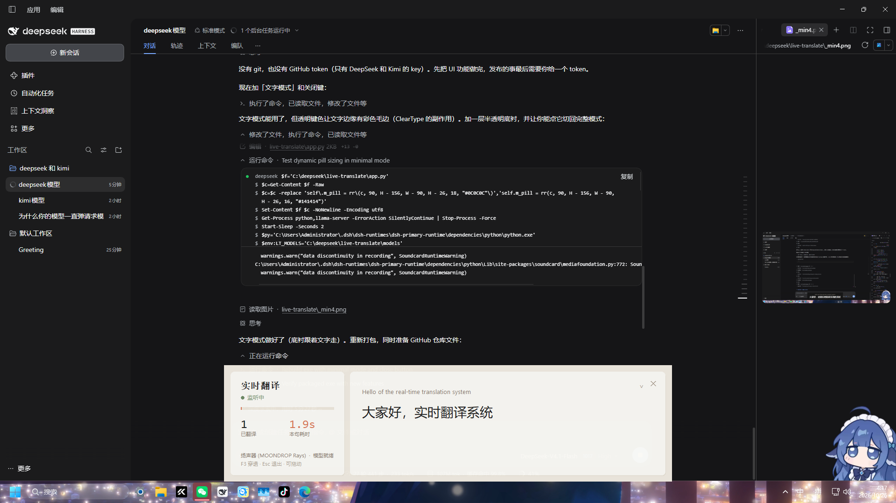
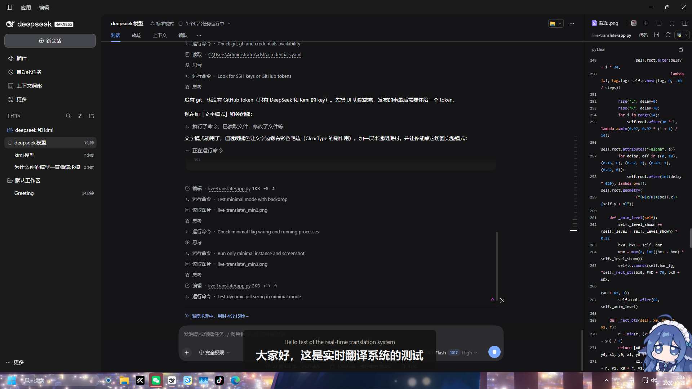

# LiveTranslate · 实时翻译字幕

把电脑正在播放的**英文声音**抓下来，实时识别并翻成中文，以悬浮字幕的形式显示在屏幕底部。

**全离线**：不联网、不花钱、声音不出本机。识别和翻译都在本机跑。



## 特性

- **抓系统声音**（WASAPI 回环），不是麦克风——看视频、开会、打游戏都能用
- **全离线**：Whisper small.en 识别 + Qwen2.5-3B 翻译，全程本地
- **快**：一句说完到出中文字幕约 1.6–2.0 秒（翻译走显卡时首字 0.12 秒）
- **小声也能听到**：底噪自适应 + 迟滞 + 块内峰值 + 自动增益（最高 +26dB），系统音量 6% 仍可识别
- **两种界面**：完整面板（状态/音量/句数/耗时）和纯文字模式（F4，只留字幕）
- **鼠标穿透**（F3），全屏看视频时不挡操作

## 界面

| 完整模式 | 文字模式（F4） |
|---|---|
|  |  |

## 下载（推荐，不用装 Python）

[**Releases v1.0.0**](https://github.com/linyanquan2026-hub/llyq/releases/tag/v1.0.0) — Windows 离线整包，2.7 GB，解压即用。

1. 把两个分卷都下载下来（**缺一个解不开**）：
   - `LiveTranslate-v1.0.0.7z.001`（1.66 GB）
   - `LiveTranslate-v1.0.0.7z.002`（1.01 GB）
2. 放进同一个文件夹，用 7-Zip 或 WinRAR 右键点 **.001** 解压（`.002` 不用管）
3. 进 `LiveTranslate` 文件夹，双击 `LiveTranslate.exe`
4. 首次启动约 10 秒把模型搬进显存，左边状态灯变绿「监听中」就能放英文视频了

SHA256（可选，校验用）：

```
02DAE5887E6EF0D0CC0E7B3D492FEF7D106920C6C324B5E0819C1A78DEA13E3C  LiveTranslate-v1.0.0.7z.001
C676CCB4B47FD2BD2CC357DC565326428E09689658925554FEC6F19281D60F2B  LiveTranslate-v1.0.0.7z.002
```

包内含：程序本体、识别模型（faster-whisper small.en）、翻译模型（Qwen2.5-3B q4_0）、llama-server（Vulkan + CPU 两版）、Python 运行时。
不写注册表，删文件夹即卸载。

## 安装（从源码，开发者）

需要 Windows 10/11 + Python 3.10+。

```powershell
git clone https://github.com/<你的用户名>/live-translate.git
cd live-translate
powershell -ExecutionPolicy Bypass -File setup.ps1
```

`setup.ps1` 会做这些事（一次性）：

1. 装 Python 依赖（`soundcard`、`faster-whisper` 等）
2. 从 **ModelScope** 下模型（约 2.4GB）：
   - `systran/faster-whisper-small.en`（识别，464MB）
   - `Qwen/Qwen2.5-3B-Instruct-GGUF` q4_0（翻译，1.9GB）
3. 从 GitHub 下 `llama.cpp` 的 Windows 二进制（Vulkan + CPU 两个版本）
4. 启动程序

## 用法

```powershell
python app.py             # 完整模式
python app.py --minimal   # 直接进纯文字模式
```

| 按键 | 作用 |
|---|---|
| `Esc` | 退出 |
| `F3` | 鼠标穿透开关 |
| `F4` | 完整模式 ↔ 纯文字模式 |
| 拖动 | 按住窗口任意位置移动 |
| 右上角 `✕` | 关闭 |
| 右上角 `⌄` | 收起成纯文字 |

## 架构

```
系统声音(WASAPI 回环)
   └─ capture.py   分句：底噪自适应 + 迟滞 + 块内峰值 + 自动增益
        └─ engine.Asr   faster-whisper small.en（CTranslate2 int8，CPU 6 线程）
             └─ engine.Mt   Qwen2.5-3B（llama-server 子进程，HTTP + 流式）
                  └─ app.Overlay   tkinter 悬浮窗，逐字流式上屏
```

关键设计：

- **翻译走独立进程**：`llama-server.exe` 由程序拉起，HTTP 调用，退出时杀掉。
  这样不用把 1.9GB 模型塞进 Python 进程，也不会拖慢识别。
- **优先 Vulkan**：`llama_vk/` 存在就用显卡（首字 0.12s），否则自动退回 CPU 版（1.7s）。
- **流式翻译**：SSE 逐 token 回调，首字就上屏，不用等整句。

## 性能（Ryzen 5 5600 / RX 7650 GRE）

| 项 | 数值 |
|---|---|
| 启动到可用 | 约 10 秒（模型搬进显存） |
| 识别 | 0.8–1.5 秒/句 |
| 翻译首字 | 0.12 秒（GPU）/ 1.7 秒（CPU） |
| 端到端 | 1.6–2.0 秒 |
| 内存 | 识别 ~350MB + 翻译 ~2.3GB 显存 |

## 打包成 exe

```powershell
python -m PyInstaller --noconfirm --clean --onedir --noconsole --name LiveTranslate `
  --exclude-module torch --exclude-module transformers --exclude-module onnxruntime `
  app.py
# 然后把 models/ llama/ llama_vk/ 拷进 dist\LiveTranslate\
```

## 已知限制

- 只翻**英文 → 中文**（换语言见下）
- 识别错则翻译跟着错（级联误差）
- 背景音乐/音效大会误触发识别
- 纯 CPU 时翻译慢 1.5 秒

## 换语言 / 换模型

- 日文：`engine.Asr.listen` 里 `language="en"` 改 `"ja"`，识别模型换多语种 `small`；翻译模型换 `Helsinki-NLP/opus-mt-ja-zh`
- 换更大翻译模型：把 `models/qwen` 换成 7B GGUF，改 `engine.Mt` 里的文件名（16GB 内存会紧）

## 踩过的坑

1. **HuggingFace 在国内下不动**（大文件被重置，Xet 协议还会卡死）→ 模型全走 **ModelScope**
2. **PyPI 官方源慢** → 用阿里云镜像
3. **Whisper 对静音会瞎编**（"you"/"thank you"）→ 必须按有声占比过滤片段，并按 `no_speech_prob`/`avg_logprob` 过滤结果
4. **门限写死会漏掉小声** → 改成滚动分位数自适应 + 迟滞
5. **transparentcolor + ClearType 会有彩色毛边** → 文字下面垫一层实色底衬
6. **PyInstaller 分析 transformers 会卡十几分钟** → 本项目最终不用 torch/transformers，绕开了

## License

MIT

